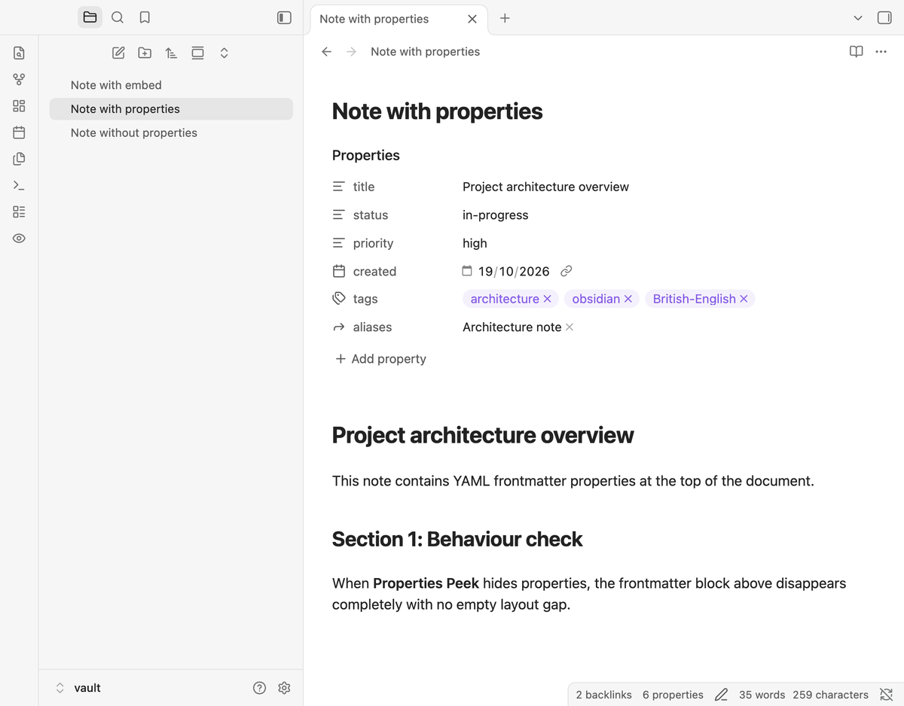
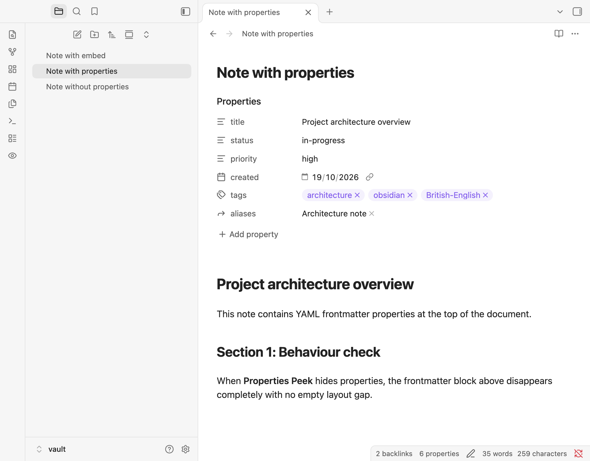
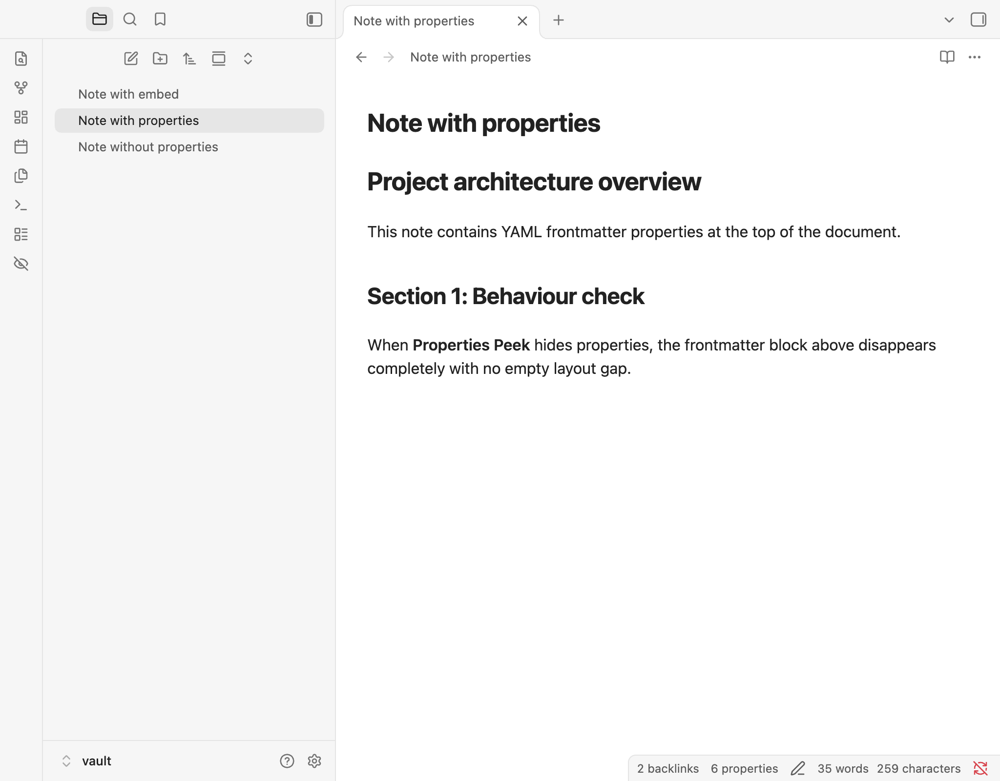
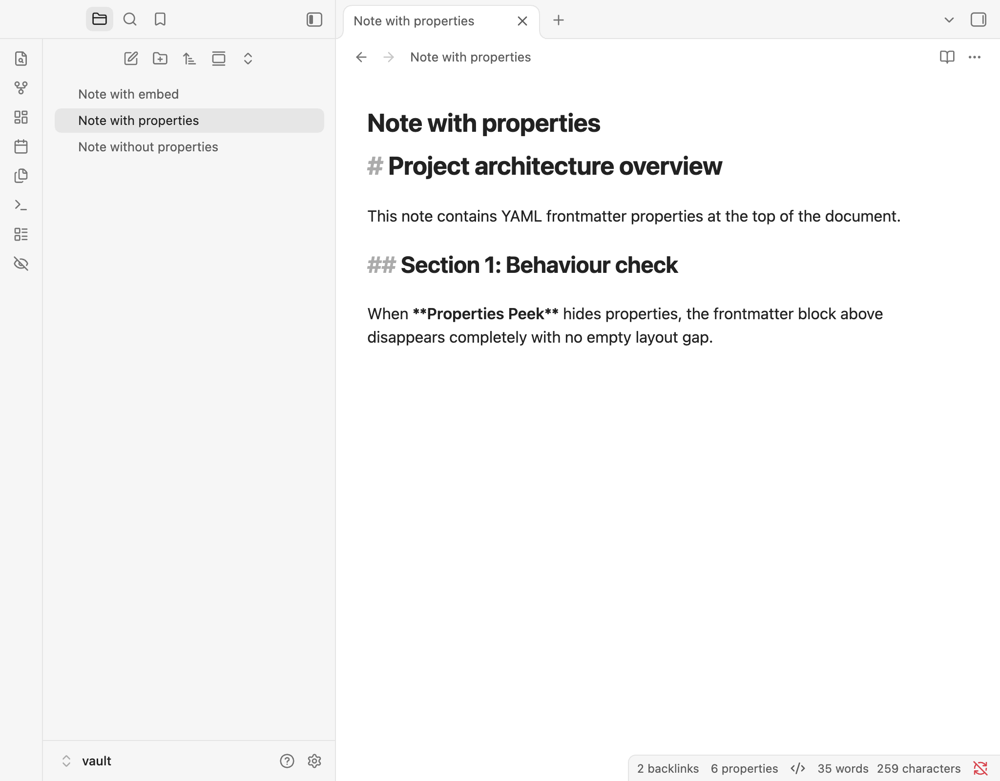
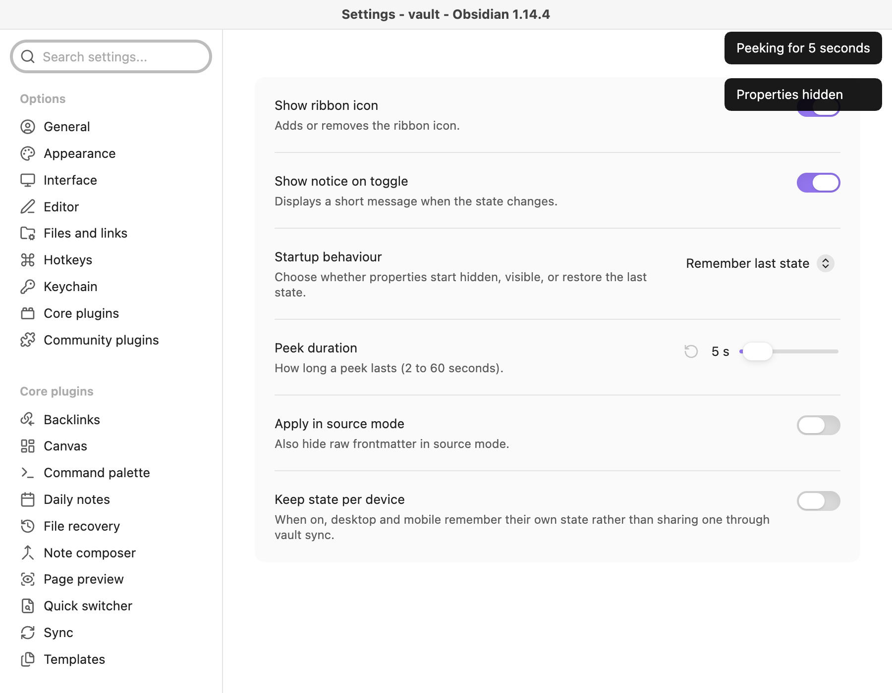

# Properties Peek for Obsidian

**Properties Peek** lets you hide the Properties (YAML frontmatter) block across your notes with a single click or key press—so your notes read cleanly as if they have no properties at all—or take a quick temporary **"peek"** before they hide again automatically.



---

## Why Properties Peek?

Obsidian's built-in setting (*Settings → Editor → Properties in document → Hidden*) can hide properties, but it comes with everyday friction:
- There is **no ribbon icon** to switch it on or off on the fly.
- There is **no one-key toggle** you can bind to a shortcut.
- There is **no quick way to glance at your properties** for a few seconds and have them hide again by themselves.
- Changing it means digging through the settings menu every single time.

**Properties Peek removes that friction on both desktop and mobile:**
1. **One-tap ribbon toggle** — Click the eye icon in the left ribbon (or mobile ribbon menu) to hide or show properties across every open note and pop-out window at once.
2. **Temporary peek** — Press your peek shortcut to reveal hidden properties for a few seconds (default `5 seconds`, customisable from `2` to `60` seconds), then let them vanish again automatically without changing your saved state.
3. **Purely visual & 100% safe** — Your note files are never modified, and Obsidian's built-in *Properties in document* setting is never touched. Frontmatter remains completely available to Dataview, Bases, search, graph view, and every other plugin.
4. **Zero layout gap** — When hidden, the properties area closes up cleanly in **Reading view**, **Live Preview**, embedded notes, hover previews, and optionally **Source mode**.

---

## Walkthrough

### 1. Hide or show properties with one click

Click the **ribbon icon** (`eye` when visible, `eye-off` when hidden) or press your assigned hotkey for **Toggle properties visibility**. Every open note updates immediately, and the space where the properties block sat closes up without leaving an empty gap.

| Properties Visible (`eye` icon) | Properties Hidden (`eye-off` icon) |
| :---: | :---: |
|  |  |

---

### 2. Take a quick "peek" without losing your hidden state

When properties are hidden and you just need to check a tag, date, or status field:
- Run **Peek at properties** from the Command Palette or your hotkey.
- Properties appear immediately with a brief notice (*"Peeking for 5 seconds"*), then hide again automatically when the timer finishes.
- **Need more time?** Trigger **Peek at properties** again mid-peek to restart the countdown, or trigger **Toggle properties visibility** mid-peek to cancel the timer and keep properties visible.

| Peeking Temporarily | Optional Source Mode Hiding |
| :---: | :---: |
|  |  |

---

### 3. Tailor startup, source mode, and per-device sync

Open **Settings → Properties Peek** to customise how the plugin behaves:



| Setting | Default | What it does |
| :--- | :---: | :--- |
| **Show ribbon icon** | `On` | Adds or removes the toggle icon in the left ribbon. |
| **Show notice on toggle** | `On` | Shows a brief on-screen notice (*"Properties hidden"*, *"Properties shown"*, *"Peeking for 5 seconds"*) when the state changes. |
| **Startup behaviour** | `Remember last state` | Choose between **Remember last state**, **Always hidden**, or **Always visible** when Obsidian starts. |
| **Peek duration** | `5 seconds` | How long a temporary peek lasts (`2` to `60` seconds). |
| **Apply in source mode** | `Off` | When switched on, also hides raw YAML frontmatter lines (`---`) while editing in Source mode. |
| **Keep state per device** | `Off` | When switched on, desktop and mobile each remember their own visibility state locally rather than sharing one through vault sync. |

---

## Commands & Hotkeys

No default hotkeys are pre-assigned so the plugin never conflicts with your existing setup. Open **Settings → Hotkeys** and filter by **Properties Peek** to bind any shortcut you like (or add commands to the mobile toolbar):

| Command | Description |
| :--- | :--- |
| **Properties Peek: Toggle properties visibility** | Switches between hidden and visible. If run during an active peek, ends the peek and leaves properties visible. |
| **Properties Peek: Peek at properties** | Temporarily reveals hidden properties for the configured duration, then hides them again automatically. |
| **Properties Peek: Hide properties** | Explicitly hides properties across all open notes (and cancels any active peek). |
| **Properties Peek: Show properties** | Explicitly shows properties across all open notes (and cancels any active peek). |

---

## Compatibility Notes

- **Properties side-panel:** The standalone *Properties* side-panel remains visible and interactive even while in-note properties are hidden.
- **Dataview & Bases:** Inline tables or lists rendered by Dataview or Bases are not YAML frontmatter blocks and remain untouched.
- **Themes & CSS snippets:** Works out of the box with Obsidian's default theme and popular community themes. Heavily customised themes or snippets that override `.metadata-container` with custom display rules may warrant testing.
- **Clean unload:** Disabling the plugin in **Settings → Community plugins** immediately removes all CSS markers, cancels any active peek timer, and restores your original appearance.

---

## Installation

### From GitHub Releases
1. Download `main.js`, `manifest.json`, and `styles.css` from the [latest release](https://github.com/jrayas/properties-peek/releases/latest).
2. In your Obsidian vault, create the folder `.obsidian/plugins/properties-peek/`.
3. Copy `main.js`, `manifest.json`, and `styles.css` into that folder.
4. Reload Obsidian and enable **Properties Peek** under **Settings → Community plugins**.

### Build from Source
```bash
git clone https://github.com/jrayas/properties-peek.git
cd properties-peek
npm install
npm run build
```

---

## Privacy & Offline Guarantee

Properties Peek runs **100% locally inside your vault**. It never modifies your Markdown files, makes zero network requests, requires no account or telemetry, and stores all settings inside your vault's standard plugin configuration.

---

## Licence

Released under the [Zero-Clause BSD (0BSD) Licence](LICENSE) © [Anthirayas](https://github.com/jrayas).
