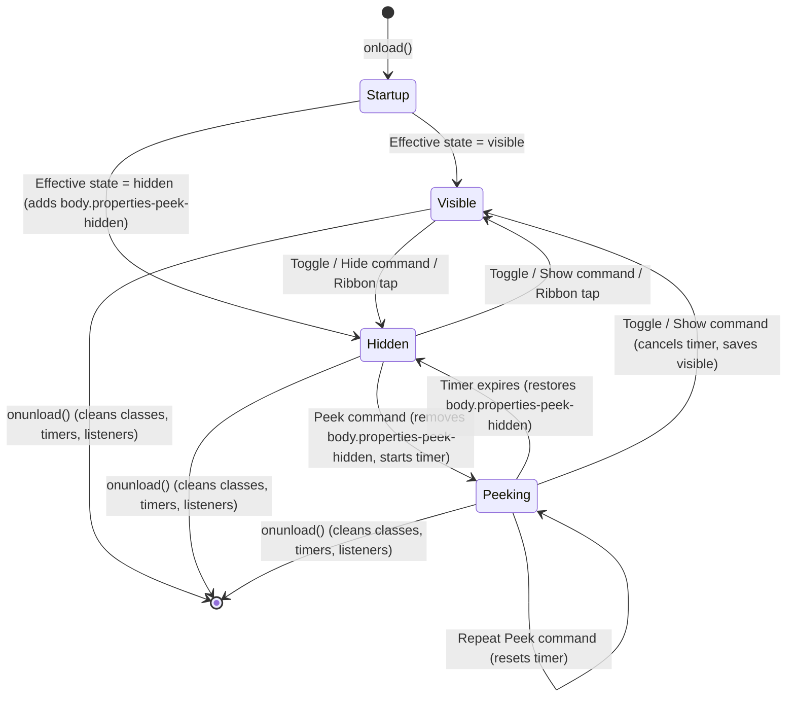

# Properties Peek — Architecture & Design

This document explains how **Properties Peek** (`properties-peek`) is architected, why specific technical decisions were made, how the state machine and multi-window DOM synchronisation work, and which CSS selectors are used to hide YAML frontmatter properties cleanly across Obsidian views.

---

## 1. Design Principles

1. **Zero File Mutation:** Note files are never read, parsed, or modified. Hiding properties is achieved purely via CSS markers on `document.body`.
2. **Non-Destructive Layering:** Obsidian's built-in *Settings → Editor → Properties in document* configuration is never altered. Disabling or unloading the plugin immediately restores the user's native configuration.
3. **Cross-Platform Compatibility (`isDesktopOnly: false`):** No Node.js or Electron-only modules are used in runtime plugin code. All timers use `window.setTimeout` / `window.clearTimeout` so the same bundle runs on macOS, Windows, Linux, iOS, iPadOS, and Android.
4. **Instant Multi-Window Reactivity:** Toggling a CSS class on the document body applies across all open panes, embedded notes, and pop-out windows in a single frame without re-rendering Markdown views.

---

## 2. State Machine & Persistence



### 2.1 Saved State vs Effective Visual State
- **Saved State (`isHidden: boolean`):** Represents the user's chosen visibility state (`true` = hidden, `false` = visible).
  - When **Keep state per device** (`keepStatePerDevice`) is `false` (default), `propertiesHidden` is read from and saved to the plugin's `data.json` via `this.loadData()` / `this.saveData()`. This syncs across devices when the vault is synced.
  - When **Keep state per device** is `true`, the hidden state is read from and written to Obsidian's vault-scoped local storage (`this.app.loadLocalStorage('properties-peek-hidden')` and `this.app.saveLocalStorage('properties-peek-hidden', ...)`), allowing desktop and mobile devices to maintain independent states.
- **Startup Override (`startupBehaviour`):**
  - `'remember'` (default): Restores the saved state on startup.
  - `'hidden'`: Forces `isHidden = true` on startup and persists it.
  - `'visible'`: Forces `isHidden = false` on startup and persists it.
- **Peek State (`isPeeking: boolean`):**
  - Ephemeral, in-memory state active only while a temporary peek timer (`peekTimeoutId`) is running.
  - **Effective Hidden State:** `const effectivelyHidden = this.isHidden && !this.isPeeking`.
  - Because `isPeeking` never writes to `data.json` or `localStorage`, the saved state remains `'hidden'` during and after a peek, even if Obsidian closes mid-peek.

### 2.2 Peek Timer Rules
- Triggering **Peek at properties** while properties are already permanently visible (`!this.isHidden`) does not start a timer; if notices are enabled, it displays `"Properties are already visible"`.
- Triggering **Peek at properties** while hidden removes `body.properties-peek-hidden`, updates the ribbon icon to `"eye"`, displays `"Peeking for X seconds"`, and starts a `window.setTimeout` for `peekDuration * 1000` ms.
- Triggering **Peek at properties** again while already peeking clears the existing timer and starts a fresh `peekDuration` countdown.
- Triggering **Toggle properties visibility** or **Show properties** during an active peek cancels the timer immediately, sets `isPeeking = false`, and sets `isHidden = false` (leaving properties permanently visible).

---

## 3. Multi-Window DOM Synchronisation

Obsidian desktop allows users to move panes into separate pop-out windows, each with its own `Window` and `HTMLDocument`. Applying a marker class only to the main window's `document.body` would leave pop-out windows unaffected.

`PropertiesPeekPlugin` tracks all active document bodies by:
1. Targeting the primary `document.body`.
2. Iterating all open workspace leaves (`this.app.workspace.iterateAllLeaves`) and collecting each leaf's `view.containerEl.ownerDocument.body`.
3. Listening to `this.registerEvent(this.app.workspace.on('window-open', (win) => ...))` so newly opened pop-out windows immediately receive the current `properties-peek-hidden` and `properties-peek-hide-source` classes.
4. Removing both classes from all tracked `document.body` elements inside `onunload()`.

---

## 4. CSS Selector Strategy (`styles.css`)

### 4.1 Reading View, Live Preview, Embeds & Hover Previews
In Obsidian 1.4+ (including 1.14.x), the in-document Properties UI is controlled by two CSS custom properties (`--metadata-display-reading` and `--metadata-display-editing`) and rendered inside `.metadata-container` within `.markdown-preview-view` and `.markdown-source-view`.

To avoid using `!important` (flagged by the Obsidian community directory CSS linter), `styles.css` combines Obsidian's native CSS custom properties with higher-specificity selectors:

```css
body.properties-peek-hidden {
	--metadata-display-reading: none;
	--metadata-display-editing: none;
}

body.properties-peek-hidden .markdown-source-view.is-live-preview.show-properties .metadata-container,
body.properties-peek-hidden .markdown-source-view .metadata-container,
body.properties-peek-hidden .markdown-preview-view.show-properties .metadata-container,
body.properties-peek-hidden .markdown-preview-view .metadata-container,
body.properties-peek-hidden .markdown-rendered .metadata-container,
body.properties-peek-hidden .markdown-embed .metadata-container,
body.properties-peek-hidden .hover-popover .metadata-container,
body.properties-peek-hidden .markdown-preview-view .frontmatter,
body.properties-peek-hidden .markdown-preview-view .frontmatter-container,
body.properties-peek-hidden .markdown-preview-view .el-pre.mod-frontmatter {
	display: none;
}
```

Scoping to markdown views/containers ensures that the standalone **Properties side-panel** (`div.workspace-leaf-content[data-type="file-properties"]`) remains functional and visible even when in-note properties are hidden.

### 4.2 Source Mode (`Apply in source mode` enabled)
To hide raw YAML frontmatter lines in Source mode without using the `:has()` pseudo-class (which causes broad selector invalidation and is flagged by the Obsidian CSS review bot) or `!important`:
1. `src/frontmatter-extension.ts` registers a lightweight CodeMirror 6 `ViewPlugin` (`frontmatterLineExtension`) that uses Obsidian's `getFrontMatterInfo()` API to decorate each YAML frontmatter line with `Decoration.line({ attributes: { class: "properties-peek-frontmatter-line" } })`.
2. When `body.properties-peek-hide-source` is active alongside `body.properties-peek-hidden`, `styles.css` hides those lines directly by class:

```css
body.properties-peek-hidden.properties-peek-hide-source .markdown-source-view.mod-cm6:not(.is-live-preview) .cm-line.properties-peek-frontmatter-line {
	display: none;
}
```
This collapses the raw YAML frontmatter lines in Source mode (including any blank lines or comments inside the frontmatter block) with zero layout gap while leaving the underlying document buffer untouched.
